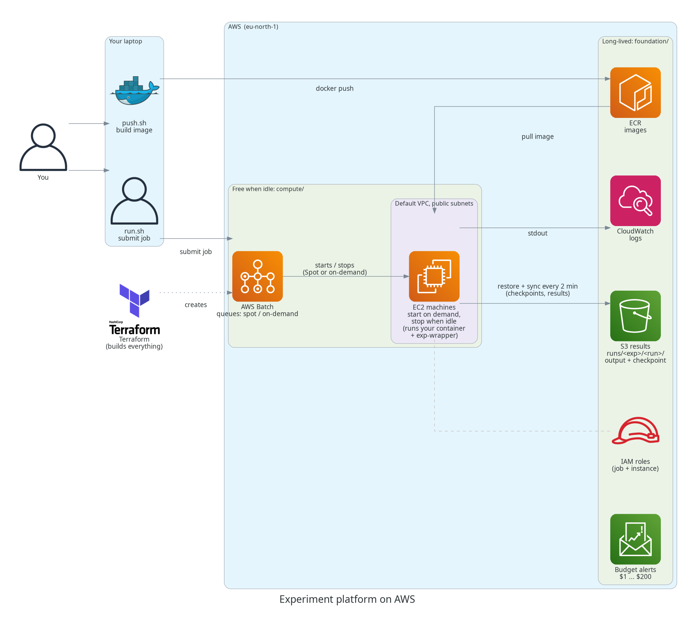

# AWS experiment platform

Run experiments, in any language, on cheap AWS Spot machines. Submit a job, it runs in a
container, results and checkpoints land in S3, and the machines disappear when the queue is
empty. Everything is built with Terraform and can be removed with one script.



**Goal: easy and cheap, not fast.** A job runs on one machine, exactly as written; nothing
is split or parallelised for you. Many independent jobs run in parallel up to a vCPU cap.

Why it is built this way, and what was rejected: [docs/decisions.md](docs/decisions.md).

## How it works

1. You package your program as a Docker image (any language) and push it to ECR.
2. `run.sh` submits it to an **AWS Batch** queue with the vCPU/memory it needs.
3. Batch starts an EC2 Spot machine, pulls the image, runs the container, and stops the
   machine when idle (scales to zero).
4. Inside the container, `exp-wrapper` restores any previous state from S3, runs your
   program, uploads results and checkpoints every 2 minutes, and does a final upload when
   the machine is reclaimed or the program ends. A retried job resumes from its checkpoint.

Spot machines can be taken back by AWS with about 2 minutes' notice. Batch retries such
jobs automatically (up to 5 times); a real failure of your program is not retried.

## Prerequisites

AWS CLI (logged in), Terraform >= 1.10, Docker, Python 3 (used by `run.sh` for JSON).
Region is `eu-north-1`.

## Setup (once)

```bash
cd terraform/bootstrap && terraform init && terraform apply            # Terraform state bucket
cd ../foundation
cp terraform.tfvars.example terraform.tfvars                           # set your email
terraform init -backend-config="bucket=$(terraform -chdir=../bootstrap output -raw state_bucket)"
terraform apply                                                        # S3, ECR, IAM, logs, budget alerts
cd ../compute
terraform init -backend-config="bucket=$(terraform -chdir=../bootstrap output -raw state_bucket)"
terraform apply                                                        # Batch queues + compute environments
```

## Using it

**Your program** reads and writes two plain folders; it needs no AWS code:

| Folder / variable | Purpose |
|---|---|
| `$OUTPUT_DIR` (`/output`) | write results here |
| `$CHECKPOINT_DIR` (`/checkpoint`) | write resumable state here; read it on start to resume |
| `$ATTEMPT` | 0 on the first try, 1+ on retries |

Write checkpoints to a temp file and rename it, so a half-written file is never uploaded.
See `examples/python-hello/` for a complete example and a Dockerfile template (only the
middle part of the Dockerfile is language-specific).

```bash
./push.sh examples/python-hello python-hello        # build + push image (tag: python-hello)
./run.sh --image python-hello --experiment hello --vcpus 1 --memory 1024 -- python main.py 30
./status.sh                                          # what exists, what is running, strays
aws s3 sync s3://exp-results-<account>-eu-north-1/runs/hello/ ./results/hello/
```

Results are stored at `runs/<experiment>/<run-id>/{output,checkpoint}/`. Submitting again
with the same `--run-id` resumes that run. Other options: `--queue spot|ondemand`,
`--sync-interval SEC`.

## Cost

Spot is roughly $0.015/hour per machine on the free plan (about $0.005 per vCPU-hour on
larger types). Idle cost is close to zero: S3, ECR and logs are cents, and machines only
exist while jobs run. An email alert fires when the month's spend crosses $1, $2, $5, $10,
$20, $50, $100, $200. Alerts do not stop anything; the real brake is `max_vcpus` per
compute environment (`terraform/compute/variables.tf`), set to the account's quotas.

## Free plan limits

The AWS free plan only lets you launch "free-tier eligible" instance types. Here that is
`c7i-flex.large` (2 vCPU, 4 GB) and `m7i-flex.large` (2 vCPU, 8 GB), so **a job cannot ask
for more than 2 vCPUs or 8 GB**. Jobs that ask for more stay `RUNNABLE` forever. On a paid
plan, change `instance_types` in `terraform/compute/variables.tf`.

## Tear down

```bash
./teardown.sh               # deletes everything, including results and the state bucket
./teardown.sh --keep-state  # keeps the Terraform state bucket
./status.sh                 # confirm nothing is left
```

Destroy order matters (compute, then foundation, then bootstrap); the script handles it.

## Repository layout

```
terraform/bootstrap/    state bucket (run once, local state)
terraform/foundation/   long-lived: S3 results, ECR, IAM, logs, budget
terraform/compute/      Batch compute environments + queues (free when idle, safe to destroy)
platform/exp-wrapper.sh checkpoint/sync wrapper baked into every image
run.sh push.sh          submit a job / build+push an image
status.sh teardown.sh   inventory / remove everything
lib.sh                  the one place scripts define resource names (must match Terraform)
examples/python-hello/  example experiment + Dockerfile template
tests/                  offline tests for the wrapper
docs/                   decisions + architecture diagram (architecture.py regenerates the PNG)
```

## Known gaps

- Recovery from a **real Spot interruption** on AWS has not been tested. The wrapper's
  interrupt-and-resume logic is tested offline only (`tests/test_wrapper.sh`).
- Job definitions are registered by `run.sh`, not Terraform (see decisions). One is created
  per image tag; `status.sh` lists them.
- `docs/architecture.png` is drawn by hand-written code and does not update itself when the
  Terraform changes.

## Keeping personal data out of the repo

- Terraform: your email lives in `terraform/foundation/terraform.tfvars` (git-ignored).
- Scripts: optional personal settings (AWS profile, prefix) go in `config.local.sh`
  (git-ignored; copy `config.local.sh.example`).
- Git identity: commits publish the author email. Use your GitHub noreply address
  (`<id>+<username>@users.noreply.github.com`):

  ```bash
  git config user.email '<id>+<username>@users.noreply.github.com'
  ```
- `tests/check_no_personal_info.sh` fails on any email address in tracked files; CI runs it.

## Development

CI (`.github/workflows/ci.yml`) runs `terraform fmt`/`validate`, `shellcheck` and
`tests/test_wrapper.sh`. Run locally: `tests/test_wrapper.sh`, `shellcheck -x *.sh platform/*.sh tests/*.sh`.
